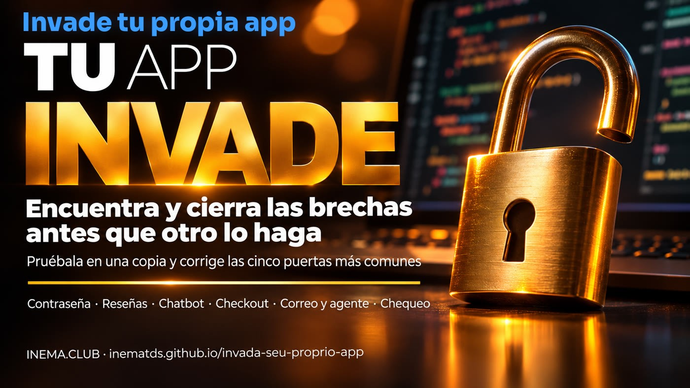

> **Uso defensivo:** solo prueba aplicaciones que sean TUYAS o que tengas permiso escrito para probar, siempre en una copia de prueba (staging/sandbox), nunca en producción con clientes. Este kit es para PROTEGER, no para invadir a los demás.

# Invada seu próprio app — kit defensivo

[](https://inematds.github.io/invada-seu-proprio-app/guia/es/)

**🇧🇷 [Português](README.md) · 🇺🇸 [English](README.en.md) · 🇪🇸 Español**

## Qué es

Invada seu próprio app es un kit de revisión defensiva con un verificador, cinco guías de brechas y prompts para organizar los resultados. Es para quien construyó una app con IA y sabe editar el proyecto, pero no trabaja con seguridad todos los días. Ayuda a buscar señales de fallas, corregir las reglas de la app y revisar el resultado antes de publicar. Para usarlo, necesitas una copia aislada de tu app, datos inventados, dos cuentas ficticias y Python 3.

## 📖 Guía de uso

https://inematds.github.io/invada-seu-proprio-app/guia/es/

¿Construiste una app con IA y quieres revisar lo que quedó expuesto? Este kit ayuda a buscar señales, corregir decisiones inseguras en el servidor y repetir las pruebas antes de publicar. Fue escrito para quien sabe editar la app, pero no trabaja con seguridad todos los días.

## Las cinco brechas

1. [Restablecimiento de contraseña](kit/brechas/01-reset-de-senha.md): un identificador que viene del navegador permite cambiar la contraseña de la cuenta equivocada.
2. [Reseñas y comentarios](kit/brechas/02-avaliacoes-e-comentarios.md): el contenido guardado se interpreta como código en el navegador de quien lo lee.
3. [Chatbot del sitio](kit/brechas/03-chatbot-do-site.md): las peticiones fuera del negocio consumen tu cuota de inferencia.
4. [Checkout y precio](kit/brechas/04-checkout-e-preco.md): el servidor acepta el valor que envió el comprador.
5. [Correo y agente](kit/brechas/05-email-e-agente.md): el agente trata las instrucciones recibidas en un mensaje como órdenes del dueño.

## Cómo usar

Sigue [COMECE AQUI](kit/COMECE-AQUI.md). Prepara dos cuentas ficticias y datos descartables en staging. Ejecuta:

```sh
python3 kit/scripts/checa.py --url https://staging.seu-app.test --eu-tenho-permissao
python3 kit/testes/run.py
```

La dirección de arriba ilustra el formato: sustitúyela por la dirección de tu copia de prueba. La flag declara tu autorización y el uso de staging; el script no puede verificar la propiedad ni el entorno.

El verificador hace un único GET, sin seguir redirecciones, sin login y sin enviar formularios. Analiza solo el HTML y el JavaScript inline recibidos: no descarga scripts externos ni visita otras rutas. Las señales no comprueban explotación; la ausencia de señales no comprueba seguridad. La autorización, los valores en la base de datos, el consumo del chatbot y las herramientas del agente exigen revisión manual.

Usa los [prompts de prueba simulada e informe visual](kit/prompts/pentest-do-seu-app.md) para organizar la revisión. Los [ejemplos locales](kit/exemplos/) son demostrativos y no tienen backend. El ejemplo vulnerable no ejecuta scripts recibidos ni envía datos.

[Dirección de la guía](https://inematds.github.io/invada-seu-proprio-app/guia/es/) — referencia de publicación; la página de la guía no forma parte de este kit.

Python 3, sin dependencias adicionales. Contenido autoral. Licencia [MIT](LICENSE).
